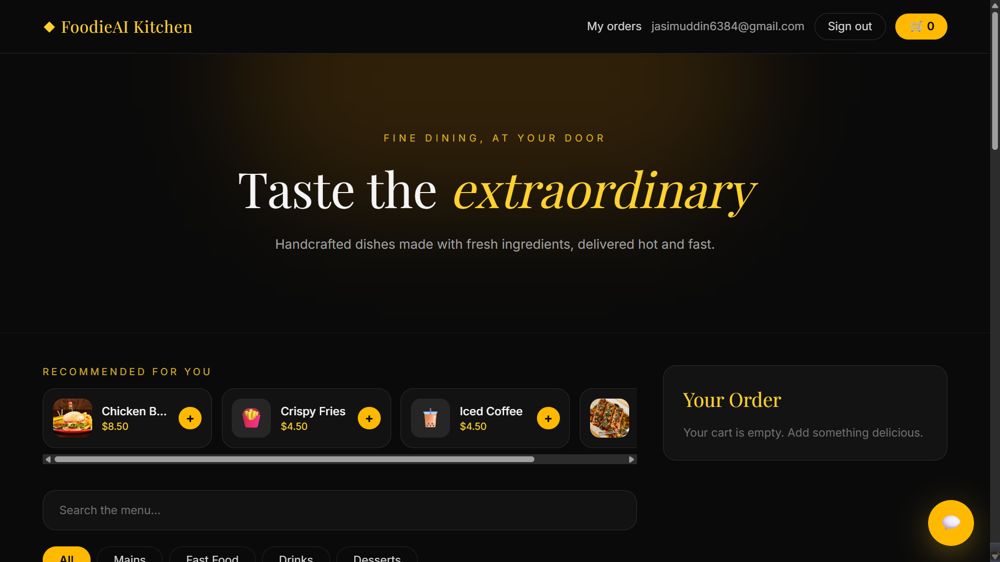
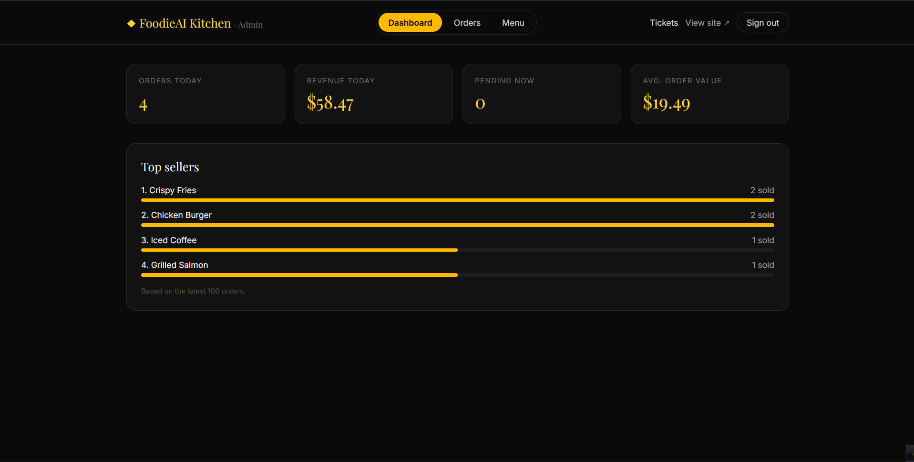
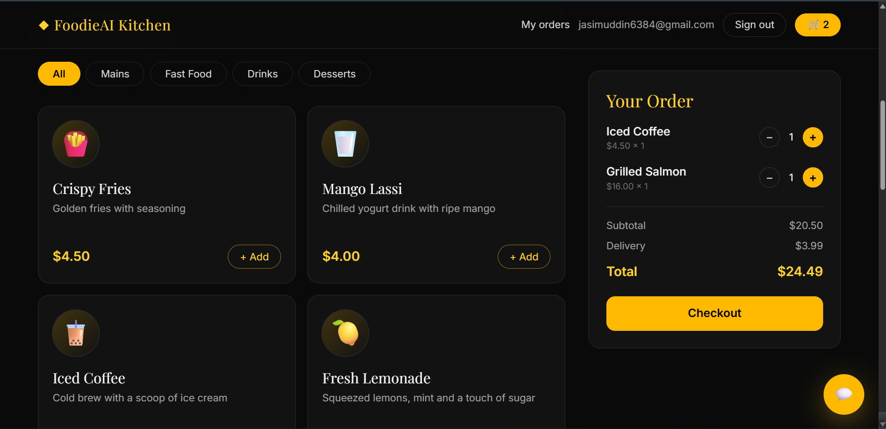
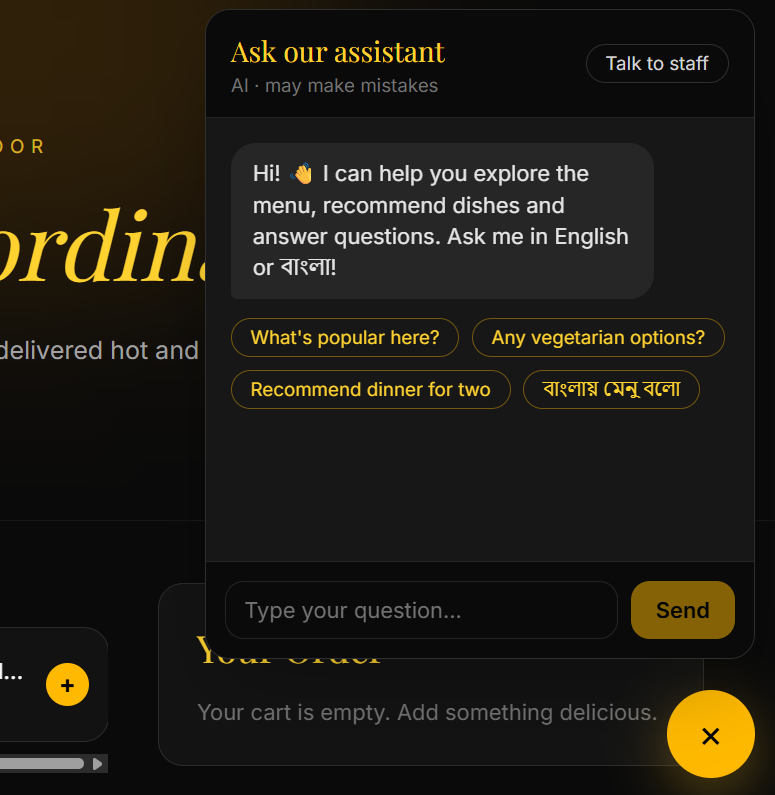

# 🍽️ FoodieAI — Restaurant Ordering Platform with AI Assistant

A full-stack, multi-tenant-ready online ordering system for restaurants: customer storefront, live admin dashboard, AI chat assistant (English + Bangla), support tickets and a recommendation engine.

**Live demo:** https://foodie-ai-rho.vercel.app

   
   
   
   

## ✨ Features

**Customer**
- Dark, responsive storefront with search and category filters
- Cart, email sign-up/sign-in, checkout (cash on delivery)
- "My Orders" page with **live order tracking** (updates without refresh)
- **AI assistant** that knows the live menu, answers in English or Bangla, and hands off to staff
- **Recommendations**: "Goes well with your order" (item-based collaborative filtering)

**Restaurant admin (`/admin`)**
- Real-time new-order alerts with sound
- Order workflow: Pending → Preparing → Out for delivery → Delivered / Cancelled
- Sales dashboard: orders today, revenue, average order value, top sellers
- Menu management: add/edit/delete items, photo upload, in-stock toggle, categories
- Support ticket inbox (`/admin/tickets`)

## 🧱 Tech stack

| Layer | Technology |
|---|---|
| Frontend | Next.js (App Router), React, Tailwind CSS |
| Backend / DB | Supabase (PostgreSQL, Auth, Storage, Realtime) |
| AI | Google Gemini API (called from a server route, key never exposed) |
| Hosting | Vercel |

## 🔒 Security design

- **Row Level Security** on every table; customers only read their own orders
- Order totals are calculated **server-side in a Postgres function** (`place_order`), so prices can't be tampered with from the browser
- Staff can only change an order's `status` column
- Admin access is enforced in the database via a `restaurant_staff` table, not just hidden in the UI
- AI API key stays on the server; per-IP rate limiting protects quota; no customer phone/address is ever sent to the AI

## 🚀 Setup

**1. Clone and install**
```bash
git clone https://github.com/ar0rafi99/FoodieAI.git
cd FoodieAI
npm install
```

**2. Create a Supabase project** (free tier works), then open **SQL Editor** and run the whole of [`schema.sql`](./schema.sql) once.

**3. Environment variables** — create `.env.local`:
```
NEXT_PUBLIC_SUPABASE_URL=your_supabase_project_url
NEXT_PUBLIC_SUPABASE_ANON_KEY=your_supabase_anon_or_publishable_key
GEMINI_API_KEY=your_google_ai_studio_key
GEMINI_MODEL=gemini-flash-latest
```
> Never put a `service_role` key in this project. Never prefix `GEMINI_API_KEY` with `NEXT_PUBLIC_`.

**4. Run**
```bash
npm run dev
```
Open http://localhost:3000, sign up, then make yourself the owner by running the commented SQL at the bottom of `schema.sql` with your email. Your admin panel is at `/admin`.

**5. Deploy** — push to GitHub, import into Vercel, add the same four environment variables, and set your Vercel URL as the **Site URL** in Supabase → Authentication → URL Configuration.

## 🗺️ Roadmap

- [ ] Subdomain-based multi-restaurant mode (`pizzahouse.yourapp.com`)
- [ ] Restaurant self-signup and subscription billing
- [ ] Online payments (Stripe / SSLCommerz / bKash)
- [ ] SMS / WhatsApp notifications
- [ ] Coupons and loyalty points

## 🤖 Development note

Built with AI-assisted development (Claude). Architecture, database design, security rules and deployment were reviewed, tested and understood by the author.
Built on Next.js 16 (stable).

## 📄 License

All rights reserved unless a license file states otherwise.
